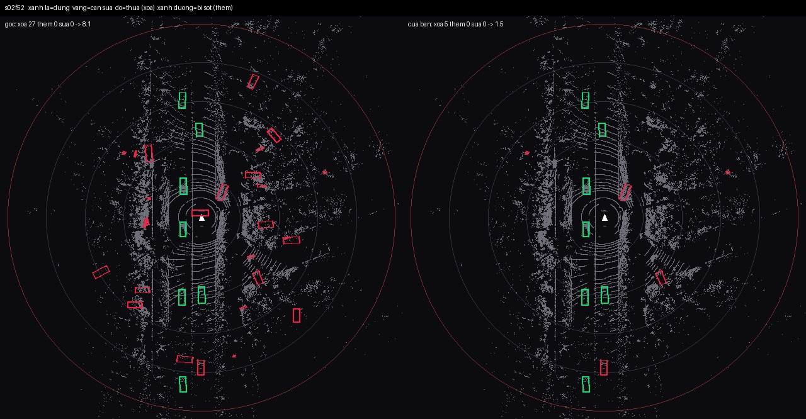

# Báo cáo Day 14 — Đào Duy Hiếu — 2A202603235

- Mã học viên dùng với `--student`: `235`
- `seed_tag` trong `frames_A.txt`: `393590736f`

## 1. Dự đoán trước sweep (bước 5b)

- Tham số tôi nghĩ giảm công sửa nhiều nhất: tăng `score_thr` lên `0.4` và đặt `min_points=5`.
- Vì sao: ở cấu hình gốc, ba frame tập A có tới 78 box thừa nhưng chỉ có 4 box bị sót. Tôi đoán việc tăng ngưỡng tin cậy và loại các box chứa quá ít điểm LiDAR sẽ giảm đáng kể số box thừa, qua đó giảm công xóa. Cấu hình lọc có thể làm tăng số box bị sót, vốn tốn công thêm hơn, nhưng với chênh lệch hiện tại giữa 78 box thừa và 4 box sót, tôi kỳ vọng chi phí sửa vẫn giảm.

## 2. Tập A: sửa tay và tune

Kết quả cấu hình gốc trên ba frame `s01f08`, `s02f52` và `s05f18`:

| Cấu hình | Xóa | Thêm | Sửa | Chi phí |
|---|---:|---:|---:|---:|
| Gốc | 78 | 4 | 0 | 27.4 |
| `best_config.json` | 13 | 5 | 0 | 8.9 |

- Tham số đã đổi trong `best_config.json`: `score_thr` tăng từ `0.1` lên `0.5`; `min_points` tăng từ `0` lên `10`.
- Kết quả leave-one-out:
  - `s01f08`: cấu hình chọn `{'score_thr': '0.5', 'min_points': '10'}` → chi phí `4.8` (tốt nhất có thể `4.8`).
  - `s02f52`: cấu hình chọn `{'score_thr': '0.5', 'min_points': '10'}` → chi phí `1.5` (tốt nhất có thể `1.5`).
  - `s05f18`: cấu hình chọn `{'score_thr': '0.5', 'min_points': '10'}` → chi phí `2.6` (tốt nhất có thể `2.6`).
- Cấu hình ổn định trong phạm vi ba frame A: khi lần lượt bỏ từng frame, hai frame còn lại đều chọn cùng `score_thr=0.5`, `min_points=10`, và chi phí trên frame bị bỏ ra đều bằng mức tốt nhất có thể. Tôi chọn cấu hình này vì nó giảm số box cần xóa từ 78 xuống 13; số box cần thêm chỉ tăng từ 4 lên 5, nên tổng chi phí giảm từ 27.4 xuống 8.9. Tuy nhiên, kết quả này vẫn có thể lạc quan do tập tune chỉ gồm ba frame.

## 3. Trước/sau (bước 8)



- `scripts/pp_compare.py` báo giảm 68% công sửa trên tập A, từ 27.4 xuống 8.9.
- Dự đoán ở mục 1 đúng về xu hướng: tăng `score_thr` và `min_points` đã loại phần lớn box thừa và làm tổng chi phí giảm mạnh. Tuy nhiên, mức tối ưu từ sweep (`score_thr=0.5`, `min_points=10`) lọc mạnh hơn mức tôi dự đoán (`score_thr=0.4`, `min_points=5`). Số box cần xóa giảm từ 78 xuống 13, trong khi số box cần thêm chỉ tăng từ 4 lên 5 và số box cần sửa vẫn là 0; vì vậy phần chi phí tiết kiệm từ việc giảm box thừa lớn hơn phần chi phí phát sinh do thêm một box bị sót.

## 4. Tập B

Số đo từ lệnh:

```powershell
python scripts/pp_prelabel.py --data "$DataVF" --frames "d14_235/frames_B.txt" --config "d14_235/best_config.json" --gt "d14_235/ref_B.json"
```

| Xóa | Thêm | Sửa | Chi phí |
|---:|---:|---:|---:|
| 42 | 15 | 4 | 29.6 |

- Loại box tốn công sửa nhất ở tập B là box bị model bỏ sót và phải thêm mới. Có 15 box cần thêm, đóng góp 15.0 điểm chi phí; trong khi 42 box cần xóa đóng góp 12.6 điểm và 4 box cần sửa đóng góp 2.0 điểm. Điều này cho thấy dù số box thừa nhiều hơn, các trường hợp bỏ sót vẫn gây tốn công đáng kể do thao tác thêm có trọng số cao nhất.

## 5. Giới hạn

- Việc tune chỉ dựa trên ba frame tập A nên cấu hình được chọn có nguy cơ overfit và không chắc khái quát tốt sang 12 frame tập B.
- PointPillars được huấn luyện trên KITTI, trong khi dữ liệu VF khác về cảm biến, góc nhìn và phân bố dữ liệu; KITTI cũng không có lớp Truck và Bus như bộ nhãn của bài.
- Chi phí `0.3·xóa + 1.0·thêm + 0.5·sửa` là thước đo quy ước, không phải thời gian sửa nhãn thực tế.
